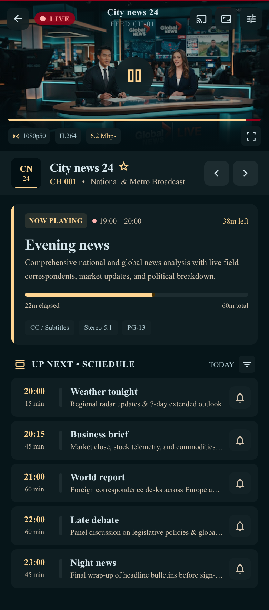
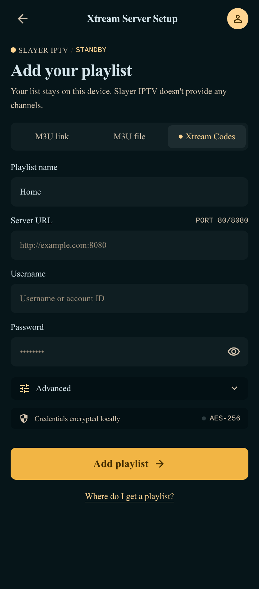

<div align="center">


# Tally

**A fast, simple and open-source IPTV player for Android phones and tablets.**

Bring your own M3U playlist or Xtream Codes account and watch live TV, movies and series,
with a TV guide, favorites and playback that picks up where you left off.

[](https://github.com/isousluer/tally-iptv/releases/latest)
[](LICENSE)
[](https://github.com/isousluer/tally-iptv/actions/workflows/ci.yml)


[**Download for Android**](https://github.com/isousluer/tally-iptv/releases/latest) ·
[Report a bug](https://github.com/isousluer/tally-iptv/issues) ·
[Build from source](#building-from-source)

</div>

---

> [!IMPORTANT]
> Tally is a **player only**. It does not include, sell or promote any channels, playlists or content.
> You need a playlist from your TV provider. Only watch content you have the right to watch.

## Screenshots

| Live TV | Player | Movies | Series | Add playlist |
| :---: | :---: | :---: | :---: | :---: |
|  |  |  |  |  |

<sub>Design mockups of the main screens.</sub>

## Features

### Playlists
- Add an **M3U / M3U8 link**, a **local M3U file** or an **Xtream Codes** login, and switch between several playlists in one tap
- Lists with 100,000+ entries open instantly: they are read once and stored on your device
- Update playlists by hand or automatically
- Hide, reorder and search categories, and sort channels and titles the way you like

### Live TV
- **TV guide (EPG)** with what's on now and next and a progress bar on every channel. XMLTV (plain or `.gz`) is picked up from the playlist or your Xtream server
- **Change channels without leaving the player**: previous and next buttons, a channel list next to the video, or a remote's Channel +/− and number keys
- Only the channel you stop on is loaded, so flicking through channels stays quick

### Movies and series
- Posters, ratings, plot, director and cast
- **Continue watching**: movies and episodes resume where you stopped
- The next episode starts on its own, with a countdown you can cancel
- Switch episodes or pick another movie from the same category right under the player

### Player
- Plays almost anything thanks to [libmpv](https://mpv.io/) (through [media_kit](https://github.com/media-kit/media-kit)): HLS, MPEG-TS, MKV, MP4 and more
- Choose audio and subtitle tracks; your language choice is remembered
- Swipe up and down for brightness (left) and volume (right), double-tap for full screen
- Picture size (fit, fill, stretch), and a 16:9 or 4:3 shape for channels that look squashed, remembered per channel
- Picture-in-picture, sleep timer and playback speed
- With a keyboard: `Space` play/pause, `F` full screen, `↑`/`↓` change channel, `←`/`→` seek, number keys jump to a channel, `B` (or the remote's Last key) goes back to the previous channel, `I` shows stream info

### Your data
- **Parental lock**: lock categories behind a PIN
- **Back up and restore** playlists, favorites, history and category settings to a file
- **Private by design**: no accounts, no analytics, no tracking. Your playlists stay on your device.

## Download

Get the latest APK from the [Releases page](https://github.com/isousluer/tally-iptv/releases/latest).
Android may ask you to allow installs from your browser or file manager the first time.

Tally runs on Android phones and tablets (Android 7.0 or newer). Other platforms such as Android TV, iOS or desktop
are not planned.

## Building from source

### Requirements

- [Flutter](https://docs.flutter.dev/get-started/install) **3.50 or newer** (stable channel)
- Android SDK and JDK 17+

### Run

```bash
git clone https://github.com/isousluer/tally-iptv.git
cd tally-iptv
flutter pub get
flutter run            # on a connected phone or emulator
```

### Release builds

```bash
flutter build apk --release --split-per-abi
```

### Tests

```bash
flutter analyze
flutter test
```

## How it works

```
lib/
├── data/            # Sources and storage (pure Dart)
│   ├── m3u_parser.dart      M3U / M3U8 parser (runs in a background isolate)
│   ├── xtream_client.dart   Xtream Codes player API client
│   ├── epg_parser.dart      Streaming XMLTV parser with gzip support
│   ├── database.dart        SQLite (sqflite)
│   └── repository.dart      Loads sources and keeps the database in sync
├── state/
│   └── providers.dart       Riverpod providers
└── ui/              # Screens and widgets
```

- Playlists are parsed once and stored in SQLite, so even huge lists open instantly.
- The TV guide is streamed and filtered to the channels in your playlist, so large guides don't fill up your device.
- Favorites and watch history are keyed by stable IDs, so they survive playlist updates.

## Design

The interface follows a "broadcast control room" idea: calm petrol-teal surfaces with one amber accent, like the
tally light on a studio camera that tells everyone you're on air. That light gives the app its name, and the icon
is the same amber lamp over the progress line you see on every channel. Red is used only for the live badge. All text uses the sans-serif
[Figtree](https://fonts.google.com/specimen/Figtree), bundled with the app (SIL Open Font License).
The mockups were made with [Stitch](https://stitch.withgoogle.com) and live in [`design/stitch`](design/stitch).

## Roadmap

- [ ] Full-screen TV guide grid
- [ ] Custom user agent and headers per playlist
- [x] Turkish and English (more translations welcome)
- [ ] Stalker / MAC portal support

## Contributing

Contributions are welcome. Please read [CONTRIBUTING.md](CONTRIBUTING.md) before opening a pull request.
Bug reports and feature requests go to the [issue tracker](https://github.com/isousluer/tally-iptv/issues).
Never post your playlist link or login in an issue.

## License

Tally is free software: you can redistribute it and/or modify it under the terms of the
[GNU General Public License v3.0](LICENSE) or (at your option) any later version.

Bundled fonts are licensed under the [SIL Open Font License 1.1](assets/fonts).
