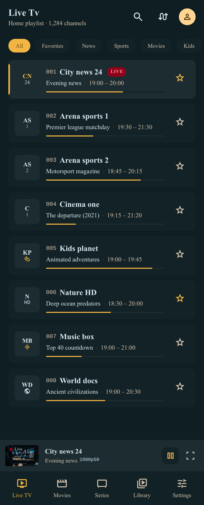
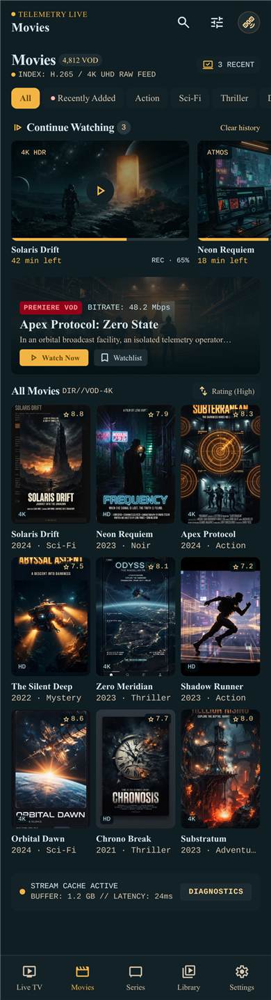
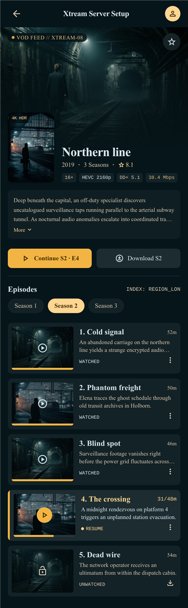

<div align="center">

# Slayer IPTV

**A fast, simple and open-source IPTV player for Android, Windows and Linux.**

Load your own M3U playlist or Xtream Codes account and watch live TV, movies and series — with a TV guide, favorites and resume playback.

[](LICENSE)


</div>

---

> [!IMPORTANT]
> Slayer IPTV is a **player only**. It does not include, sell or promote any channels, playlists or content.
> You need a playlist from your TV provider. Only use content you have the right to watch.

## Screenshots

| Live TV | Player | Movies | Series | Add playlist |
| :---: | :---: | :---: | :---: | :---: |
|  |  |  |  |  |

<sub>Design mockups. Screenshots of the running app will replace them before the first release.</sub>

## Features

- **Three ways to add a playlist** — M3U / M3U8 link, local M3U file, or Xtream Codes login
- **Live TV** with categories, search, channel numbers and quick channel switching
- **TV guide (EPG)** — see what's on now and next, with a progress bar for every channel. Supports XMLTV (plain or `.gz`), picked up automatically from the playlist or your Xtream server
- **Movies and series** with posters, ratings, seasons and episodes (Xtream Codes)
- **Continue watching** — movies and episodes resume where you stopped
- **Favorites and history** for channels, movies and series
- **Multiple playlists** — switch between them in one tap
- **Powerful playback** via [libmpv](https://mpv.io/) (through [media_kit](https://github.com/media-kit/media-kit)): HLS, MPEG-TS, MKV, MP4, multiple audio tracks and subtitles
- **Keyboard shortcuts** on desktop: `Space` play/pause, `F` full screen, `↑`/`↓` change channel, `←`/`→` seek
- **Private by design** — no accounts, no analytics, no tracking. Your playlists stay on your device.

## Download

Releases are published on the [Releases page](../../releases).

| Platform | Status |
| --- | --- |
| Android (phone and tablet) | ✅ First target |
| Windows | 🛠️ In progress |
| Linux | 🛠️ In progress |
| macOS, iOS | 📅 Planned |

## Building from source

### Requirements

- [Flutter](https://docs.flutter.dev/get-started/install) **3.50 or newer** (stable channel)
- **Android:** Android SDK and JDK 17+
- **Windows:** Visual Studio 2022 with the *Desktop development with C++* workload. On Windows you also need **Developer Mode** turned on (Flutter plugins use symlinks).
- **Linux:** `sudo apt install clang cmake ninja-build pkg-config libgtk-3-dev libmpv-dev mpv`

### Run

```bash
git clone https://github.com/slayer-iptv/slayer-iptv.git
cd slayer-iptv
flutter pub get
flutter run            # pick a connected device
```

### Release builds

```bash
flutter build apk --release --split-per-abi   # Android
flutter build windows --release               # Windows
flutter build linux --release                 # Linux
```

### Tests

```bash
flutter analyze
flutter test
```

## How it works

```
lib/
├── data/            # Sources and storage (pure Dart)
│   ├── m3u_parser.dart      M3U / M3U8 parser (runs in a background isolate)
│   ├── xtream_client.dart   Xtream Codes player API client
│   ├── epg_parser.dart      Streaming XMLTV parser with gzip support
│   ├── database.dart        SQLite (sqflite / sqflite_common_ffi on desktop)
│   └── repository.dart      Loads sources and keeps the database in sync
├── state/
│   └── providers.dart       Riverpod providers
└── ui/              # Screens and widgets
```

- Playlists are parsed once and stored in SQLite, so even lists with 100,000+ entries open instantly.
- The TV guide is streamed and filtered to the channels in your playlist, so large guides don't fill up your device.
- Favorites and watch history are keyed by stable IDs, so they survive playlist updates.

## Design

The interface follows a "broadcast control room" idea: calm petrol-teal surfaces with one amber accent, like the tally light on a studio camera. Red is used only for the live badge. All text uses the clean sans-serif [Figtree](https://fonts.google.com/specimen/Figtree), bundled with the app (SIL Open Font License). The mockups were made with [Stitch](https://stitch.withgoogle.com) and live in [`design/stitch`](design/stitch).

## Roadmap

- [ ] Windows and Linux releases
- [ ] Full-screen TV guide grid
- [ ] Android TV (D-pad navigation)
- [ ] Picture-in-picture on Android
- [ ] Custom user agent and headers per playlist
- [ ] Translations
- [ ] Stalker / MAC portal support
- [ ] macOS and iOS

## Contributing

Contributions are welcome! Please read [CONTRIBUTING.md](CONTRIBUTING.md) before opening a pull request.
Bug reports and feature requests go to the [issue tracker](../../issues).

## License

Slayer IPTV is free software: you can redistribute it and/or modify it under the terms of the
[GNU General Public License v3.0](LICENSE) or (at your option) any later version.

Bundled fonts are licensed under the [SIL Open Font License 1.1](assets/fonts).
